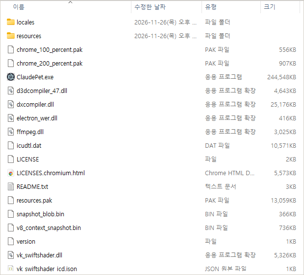
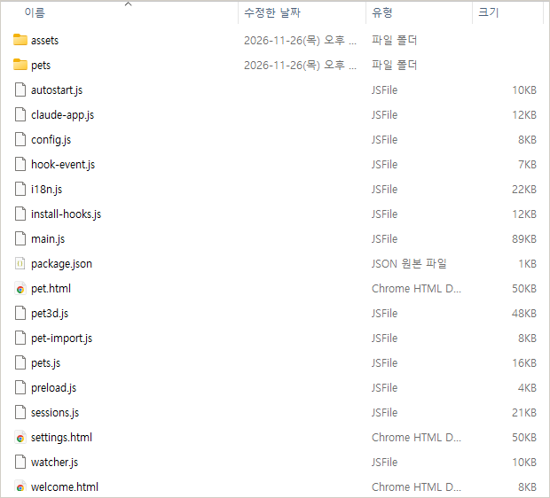
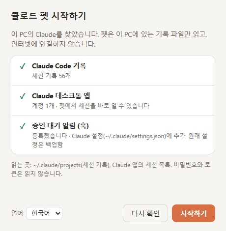
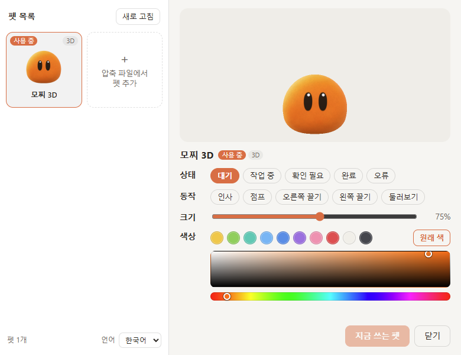
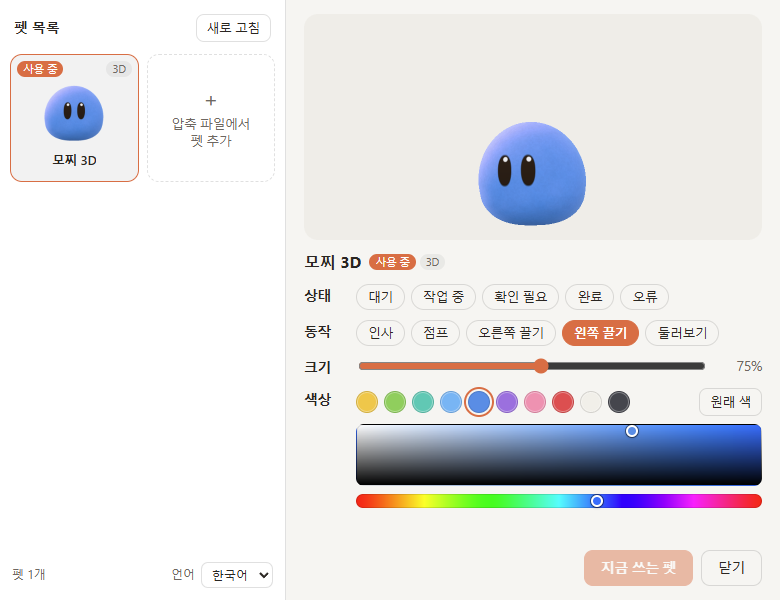

<p align="right">
  <a href="README.md"></a>
  <a href="README.ko.md"></a>
</p>

# 클로드 펫

Claude Code 세션의 진행 상황을 화면 위 펫으로 보여 주는 데스크톱 프로그램입니다.
작업 중인 내용을 말풍선으로 보여 주고, 끝나거나 승인이 필요하면 움직임과 소리로 알려 줍니다.


<sub>왼쪽부터 작업 중 · 확인 필요 · 완료 · 오류</sub>

---

## 내려받기

| 운영체제 | 파일 | 상태 |
|---|---|---|
| 윈도우 10 / 11 (x64) | `ClaudePet-<버전>-win-x64.zip` | ✅ [Releases에서 받기](../../releases/latest) |
| macOS (Apple 칩) | `ClaudePet-<버전>-mac-arm64.zip` | 🕓 준비 중 |
| macOS (Intel) | `ClaudePet-<버전>-mac-x64.zip` | 🕓 준비 중 |

Node.js 같은 다른 프로그램은 필요 없습니다. Release마다 파일별 SHA-256 값을 적어 두어, 받은 파일이 맞는지 확인할 수 있습니다.

### 윈도우

1. zip을 풀고 `ClaudePet.exe`를 실행합니다.
2. 코드 서명이 없는 프로그램이라 처음 한 번 **"Windows의 PC 보호"** 창이 뜰 수 있습니다. **추가 정보 → 실행**을 누릅니다.
   압축을 풀기 **전에** zip을 우클릭 → 속성 → **차단 해제**를 체크하면 이 창이 뜨지 않습니다.
3. 받은 파일을 확인하려면 Release에 적힌 값과 비교합니다.

   ```powershell
   Get-FileHash .\ClaudePet-<버전>-win-x64.zip
   ```

| 압축을 푼 폴더 | 프로그램 파일 (`resources\app`) |
|---|---|
|  |  |

`ClaudePet.exe`는 [Electron](https://www.electronjs.org/) 실행 파일의 이름만 바꾼 것이고, 프로그램 본체는 `resources\app` 폴더의 파일들입니다. 이 저장소의 소스와 같습니다.

### macOS (준비 중)

맥판은 만들어 두었지만 아직 맥에서 확인하지 않았습니다. 배포되면 이렇게 씁니다.

1. zip을 풀고 **`Claude Pet.command`**를 우클릭 → **열기** → **열기**를 누릅니다 (서명이 없어서 처음 한 번만).
2. 그 뒤에는 두 번 눌러 실행하면 됩니다.

## 처음 실행하면



- **Claude 자동 연결**: 이 PC에 있는 Claude Code 기록(`~/.claude/projects`)과 Claude 데스크톱 앱을 찾습니다. 로그인이나 비밀번호 입력은 없고, 비밀번호와 토큰은 읽지 않습니다.
- **승인 대기 알림(훅)**: Claude가 승인을 기다리는 순간을 알 수 있게 `~/.claude/settings.json`에 훅을 자동으로 등록합니다. 다른 도구가 등록한 훅은 그대로 두고, 바꾸기 전 설정을 백업합니다. 메뉴에서 끄면 펫이 넣은 훅만 지웁니다.
- **화면 언어**: 컴퓨터 언어를 따릅니다(한국어 PC는 한국어, 그 밖은 영어). 메뉴나 펫 꾸미기 창에서 바꿀 수 있습니다.

## 쓰는 법

| 동작 | 하는 일 |
|---|---|
| 펫 클릭 | 진행 중인 세션을 Claude 앱에서 엽니다 |
| 말풍선 클릭 | 말풍선에 나온 세션을 엽니다. `+N`을 누르면 세션 목록이 나옵니다 |
| 펫 끌기 | 위치를 옮깁니다 (기억됨) |
| 우클릭 / 알림 영역 아이콘 | 메뉴: 펫 꾸미기, 세션 목록, 말풍선·알림음, 자동 실행, 승인 대기 알림, 언어, 연결 상태 보기, 종료 |

### 펫 꾸미기

| | |
|---|---|
|  |  |

- **미리보기**: "상태" 줄과 "동작" 줄로 펫의 동작 9개를 모두 볼 수 있습니다. 대기 상태에서는 마우스를 따라 바라봅니다.
- **크기와 색상**: 고르는 대로 실제 펫에 바로 반영됩니다. 색상은 3D 펫(모찌 3D)에서 바꿀 수 있습니다.
- **코덱스 펫 추가**: 목록의 **압축 파일에서 펫 추가**를 누르거나 창에 `.zip`을 끌어다 놓습니다. [codex-pets.net](https://codex-pets.net)에서 받은 파일을 그대로 넣으면 됩니다. 가져온 펫은 카드의 ×로 지웁니다.

## 이 프로그램이 하는 일 (보안)

| | 위치 | 내용 |
|---|---|---|
| 읽기 | `~/.claude/projects` | Claude Code 세션 기록 (진행 상태 판단용) |
| 읽기 | Claude 앱 데이터의 세션 목록 | 세션 열기용. 비밀번호·토큰은 읽지 않음 |
| 쓰기 | `~/.claude/settings.json` | 승인 대기 알림 훅 (백업 후, 다른 도구 훅 유지) |
| 쓰기 | `~/.claude-pet` | 설정, 로그, 가져온 펫 |
| 쓰기 | 윈도우: 레지스트리 `Run` 값 · macOS: `~/Library/LaunchAgents` | **컴퓨터 켤 때 자동 실행**을 켰을 때만 |

- **인터넷에 연결하지 않습니다.** 시험(`tests/wiring.test.js`)이 프로그램 코드에 네트워크 코드와 외부 주소가 없는지 확인합니다.
- **가져오는 펫 압축 파일**은 검사합니다. `pet.json`과 시트 그림 두 파일만 꺼내고, 실행 파일, 펫 폴더 밖을 가리키는 경로, 너무 큰 파일, 압축 폭탄은 받지 않습니다.

## 지우기

1. 펫 메뉴에서 **승인 대기 알림 (훅)**과 **컴퓨터 켤 때 자동 실행**을 끕니다.
2. 메뉴에서 **종료**를 누릅니다.
3. 프로그램 폴더와 사용자 폴더의 `.claude-pet` 폴더를 지웁니다.

## 소스에서 실행하기

[Node.js](https://nodejs.org/) 18 이상이 필요합니다. Electron은 처음 실행할 때 `~/.claude-pet/runtime`에 자동으로 설치됩니다.

```powershell
node launch.js            # 실행 (맥에서는 "펫 실행.command"를 두 번 눌러도 됨)
node launch.js --demo     # 가짜 세션으로 미리보기
node --test               # 시험
node tools/package.js --platform=win      # 윈도우 zip 만들기 (~/.claude-pet/dist)
node tools/package.js --platform=mac      # 맥 zip 만들기 (맥용 Electron 공식 파일을 한 번 받음)
```

자세한 구조와 동작은 [docs/DEVELOPMENT.ko.md](docs/DEVELOPMENT.ko.md)에 있습니다.

## 알아 둘 점

- Claude Code 세션(데스크톱 앱 Code 탭, CLI, IDE 확장)만 보여 줍니다. 일반 채팅은 볼 수 없습니다.
- 세션 열기는 Claude 데스크톱 앱에서 만든 세션에만 정확히 동작합니다.
- 펫 화면은 한국어와 영어를 지원합니다. 세션 제목처럼 사용자가 쓴 글은 그대로 보입니다.
