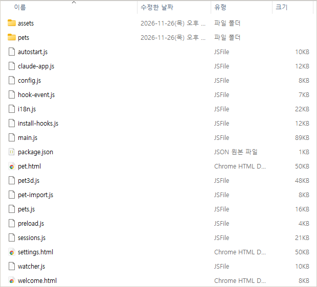
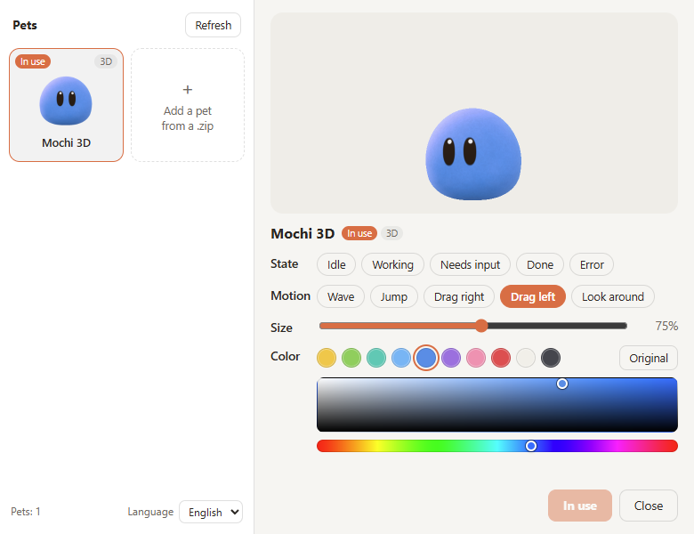

<p align="right">
  <a href="README.md"></a>
  <a href="README.ko.md"></a>
</p>

# Claude Pet

> **Unofficial.** Claude Pet is a personal project. It is not made by, affiliated with, or endorsed by Anthropic. "Claude" is a trademark of Anthropic.

A desktop pet that shows the progress of your Claude Code sessions.
It shows what Claude is doing in a speech bubble, and tells you with motion and sound when a turn is done or needs your approval.


<sub>Left to right: Working · Needs your input · All done · Stopped with an error</sub>

---

## Download

| Platform | File | Status |
|---|---|---|
| Windows 10 / 11 (x64) | `ClaudePet-<version>-win-x64.zip` | ✅ [Download from Releases](../../releases/latest) |
| macOS (Apple silicon) | `ClaudePet-<version>-mac-arm64.zip` | 🕓 Coming soon |
| macOS (Intel) | `ClaudePet-<version>-mac-x64.zip` | 🕓 Coming soon |

No Node.js or other software is needed. Each release lists the SHA-256 of every file so you can check your download.

### Windows

1. Extract the zip and run `ClaudePet.exe`.
2. The program is not code-signed, so Windows may show **"Windows protected your PC"** the first time. Click **More info → Run anyway**.
   To avoid it, right-click the zip **before extracting** → Properties → check **Unblock**.
3. Optional: compare the hash with the release notes.

   ```powershell
   Get-FileHash .\ClaudePet-<version>-win-x64.zip
   ```

| Extracted folder | The program (`resources\app`) |
|---|---|
|  |  |

`ClaudePet.exe` is the [Electron](https://www.electronjs.org/) runtime renamed. The program itself is the files in `resources\app`, the same as the source in this repository.

### macOS (coming soon)

The macOS build is prepared but not yet tested on a Mac. When it is released:

1. Extract the zip and right-click **`Claude Pet.command`** → **Open** → **Open** (first time only, because the program is not signed).
2. After that, double-click it to start the pet.

## First run


- **Connects to Claude automatically.** It finds your Claude Code history (`~/.claude/projects`) and the Claude desktop app on this computer. There is no sign-in and no password. It never reads passwords or tokens.
- **Approval alerts (hooks).** It adds hooks to `~/.claude/settings.json` so it knows when Claude waits for your approval. Hooks from other tools are kept, and the original file is backed up. Turning this off in the menu removes only the pet's hooks.
- **Language.** It follows your computer's language (Korean on Korean systems, English otherwise). You can change it in the menu or in the Customize window.

## Using the pet

| Action | What happens |
|---|---|
| Click the pet | Opens the active session in the Claude app |
| Click the bubble | Opens the session shown in the bubble. Click `+N` for the session list |
| Drag the pet | Moves it (the position is remembered) |
| Right-click / tray icon | Menu: Customize pet, sessions, bubble and sounds, start at login, approval alerts, language, connection status, quit |

### Customize pet

| | |
|---|---|
|  |  |

- **Preview** all 9 motions with the **State** and **Motion** rows. In Idle, the pet looks at your cursor.
- **Size and color** apply to the real pet right away. Color is for the 3D pet (Mochi 3D).
- **Add Codex pets.** Click **Add a pet from a .zip**, or drop a `.zip` onto the window. Archives from [codex-pets.net](https://codex-pets.net) work as they are. Delete an imported pet with the × on its card.

## What it does (security)

| | Where | Why |
|---|---|---|
| Reads | `~/.claude/projects` | Claude Code session history, to know each session's state |
| Reads | The Claude app's session list | To open a session. Never reads passwords or tokens |
| Writes | `~/.claude/settings.json` | Approval-alert hooks (backed up first; other tools' hooks are kept) |
| Writes | `~/.claude-pet` | Settings, log, imported pets |
| Writes | Windows: registry `Run` value · macOS: `~/Library/LaunchAgents` | Only when you turn on **Start at login** |

- **It never connects to the internet.** A test (`tests/wiring.test.js`) checks that the program has no network code and no outside addresses.
- **Imported pet archives** are checked: only `pet.json` and the sprite sheet are extracted. Executables, paths that leave the pet folder, oversized files and zip bombs are rejected.
- **Found a security problem?** Please report it privately as described in [SECURITY.md](SECURITY.md), not in a public issue.

## Uninstall

1. In the pet menu, turn off **Approval alerts (hooks)** and **Start at login**.
2. Choose **Quit**.
3. Delete the program folder and the `.claude-pet` folder in your user folder.

## Run from source

Requires [Node.js](https://nodejs.org/) 18 or later. On first run, Electron is installed into `~/.claude-pet/runtime`.

```powershell
node launch.js            # run (on macOS you can also double-click "펫 실행.command")
node launch.js --demo     # preview with fake sessions
node --test               # tests
node tools/package.js --platform=win      # build the Windows zip into ~/.claude-pet/dist
node tools/package.js --platform=mac      # build the macOS zips (downloads the official Electron for macOS once)
```

The internal design notes are in Korean: [docs/DEVELOPMENT.ko.md](docs/DEVELOPMENT.ko.md).

## Good to know

- It shows Claude Code sessions only (desktop app Code tab, CLI, IDE extensions). Regular chats are not shown.
- Opening a session works exactly only for sessions created in the Claude desktop app.
- The pet's UI is available in English and Korean. Session titles you wrote stay as you wrote them.
- This is a personal project, so replies to issues can take some time. When you attach a log (`~/.claude-pet`), remove your session titles first.

## License

[MIT](LICENSE). This covers everything in this repository, including the Mochi pet.
