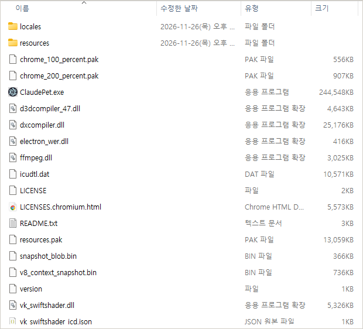
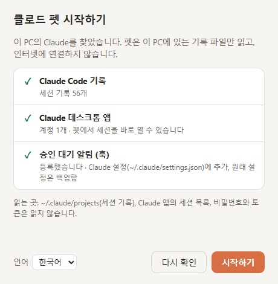
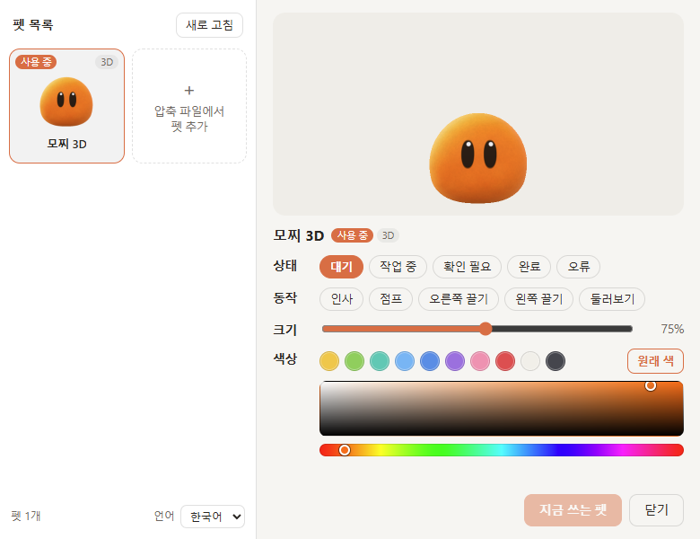
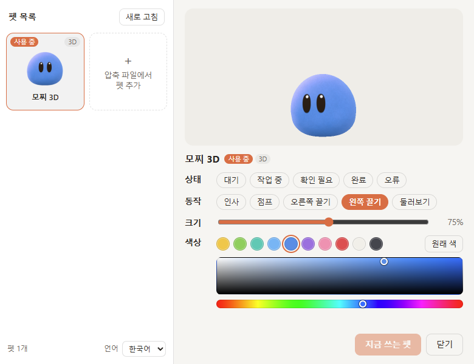
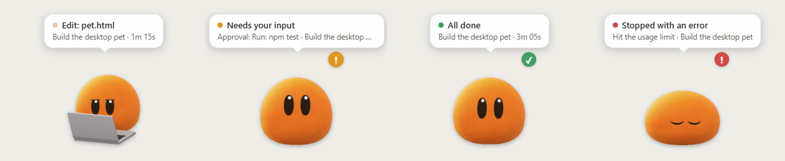
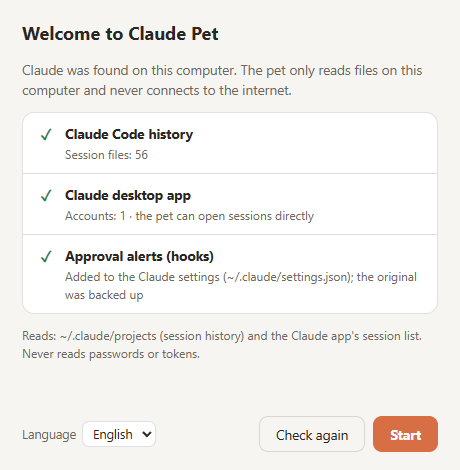
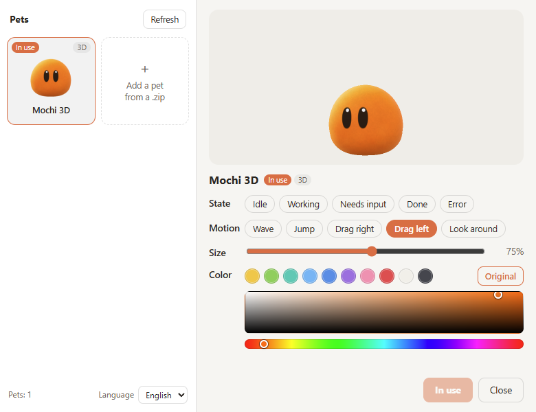

# 클로드 펫 · Claude Pet

Claude Code 세션의 진행 상황을 화면 위 펫으로 보여 주는 윈도우 데스크톱 프로그램입니다.
작업 중인 내용을 말풍선으로 보여 주고, 끝나거나 승인이 필요하면 움직임과 소리로 알려 줍니다.

*A Windows desktop pet that shows the progress of your Claude Code sessions. [English below](#english)*


<sub>왼쪽부터 작업 중 · 확인 필요 · 완료 · 오류</sub>

---

## 내려받기

[**Releases**](../../releases/latest)에서 `ClaudePet-<버전>-win-x64.zip`을 받습니다. Node.js 같은 다른 프로그램은 필요 없습니다.

1. zip을 풀고 `ClaudePet.exe`를 실행합니다.
2. 처음 한 번 "Windows의 PC 보호" 창이 뜨면 **추가 정보 → 실행**을 누릅니다. 코드 서명이 없는 프로그램이라서 뜨는 창입니다.
   - 압축을 풀기 **전에** zip을 우클릭 → 속성 → **차단 해제**를 체크하면 이 창이 뜨지 않습니다.
3. 받은 파일이 맞는지 확인하려면 Release에 적힌 SHA-256 값과 비교합니다.

   ```powershell
   Get-FileHash .\ClaudePet-1.0.0-win-x64.zip
   ```

| 압축을 푼 폴더 | 프로그램 파일 (`resources\app`) |
|---|---|
|  |  |

`ClaudePet.exe`는 [Electron](https://www.electronjs.org/) 실행 파일의 이름만 바꾼 것이고, 프로그램 본체는 `resources\app` 폴더의 파일들입니다. 이 저장소의 소스와 같습니다.

## 처음 실행하면



- **Claude 자동 연결**: 이 PC에 있는 Claude Code 기록(`~/.claude/projects`)과 Claude 데스크톱 앱을 찾습니다. 로그인이나 비밀번호 입력은 없고, 비밀번호와 토큰은 읽지 않습니다.
- **승인 대기 알림(훅)**: Claude 설정(`~/.claude/settings.json`)에 훅을 자동으로 등록합니다. 다른 도구가 등록한 훅은 그대로 두고, 바꾸기 전 설정을 백업합니다. 메뉴에서 끄면 펫이 넣은 훅만 지웁니다.
- **화면 언어**: 컴퓨터 언어를 따릅니다(한국어 PC는 한국어, 그 밖은 영어). 메뉴나 펫 꾸미기 창에서 바꿀 수 있습니다.

## 쓰는 법

| 동작 | 하는 일 |
|---|---|
| 펫 클릭 | 진행 중인 세션을 Claude 앱에서 엽니다 |
| 말풍선 클릭 | 말풍선에 나온 세션을 엽니다. `+N`을 누르면 세션 목록이 나옵니다 |
| 펫 끌기 | 위치를 옮깁니다 (기억됨) |
| 우클릭 / 알림 영역 아이콘 | 메뉴: 펫 꾸미기, 세션 목록, 말풍선·알림음, 자동 실행, 승인 대기 알림, 언어, 연결 상태 보기, 종료 |

### 펫 꾸미기

| | |
|---|---|
|  |  |

- **미리보기**: "상태" 줄과 "동작" 줄로 펫의 동작 9개를 모두 볼 수 있습니다. 대기 상태에서는 마우스를 따라 바라봅니다.
- **크기와 색상**: 고르는 대로 실제 펫에 바로 반영됩니다. 색상은 3D 펫(모찌 3D)에서 바꿀 수 있습니다.
- **코덱스 펫 추가**: 목록의 "압축 파일에서 펫 추가"를 누르거나 창에 `.zip`을 끌어다 놓습니다. [codex-pets.net](https://codex-pets.net)에서 받은 파일을 그대로 넣으면 됩니다. 가져온 펫은 카드의 ×로 지웁니다.

## 이 프로그램이 하는 일 (보안)

| | 위치 | 내용 |
|---|---|---|
| 읽기 | `~/.claude/projects` | Claude Code 세션 기록 (진행 상태 판단용) |
| 읽기 | Claude 앱 데이터의 세션 목록 | 세션 열기용. 비밀번호·토큰은 읽지 않음 |
| 쓰기 | `~/.claude/settings.json` | 승인 대기 알림 훅 (백업 후, 다른 도구 훅 유지) |
| 쓰기 | `~/.claude-pet` | 설정, 로그, 가져온 펫 |
| 쓰기 | 레지스트리 Run 값 | 메뉴에서 "컴퓨터 켤 때 자동 실행"을 켰을 때만 |

- **인터넷에 연결하지 않습니다.** 시험(`tests/wiring.test.js`)이 프로그램 코드에 네트워크 코드와 외부 주소가 없는지 확인합니다.
- 펫 압축 파일에서는 `pet.json`과 시트 그림 두 파일만 꺼냅니다. 실행 파일, 폴더 밖을 가리키는 경로, 너무 큰 파일, 압축 폭탄은 받지 않습니다.

## 지우기

1. 펫 메뉴에서 **승인 대기 알림 (훅)**과 **컴퓨터 켤 때 자동 실행**을 끕니다.
2. 메뉴에서 **종료**를 누릅니다.
3. 프로그램 폴더와 사용자 폴더의 `.claude-pet` 폴더를 지웁니다.

## 소스에서 실행하기

[Node.js](https://nodejs.org/) 18 이상이 필요합니다. Electron은 처음 실행할 때 `~/.claude-pet/runtime`에 자동으로 설치됩니다.

```powershell
node launch.js            # 실행
node launch.js --demo     # 가짜 상태로 미리보기
node --test               # 시험
node tools/package.js --platform=win   # 배포 zip 만들기 (~/.claude-pet/dist)
```

자세한 구조와 동작은 [docs/DEVELOPMENT.ko.md](docs/DEVELOPMENT.ko.md)에 있습니다.

## 알아 둘 점

- Claude Code 세션(데스크톱 앱 Code 탭, CLI, IDE 확장)만 보여 줍니다. 일반 채팅은 볼 수 없습니다.
- 세션 열기는 Claude 데스크톱 앱에서 만든 세션에만 정확히 동작합니다.
- 지금은 윈도우판만 배포합니다. 맥판은 만들 수는 있지만 아직 맥에서 확인하지 않았습니다.

---

<a id="english"></a>

## English



<sub>Working · Needs your input · All done · Stopped with an error</sub>

### Download

Get `ClaudePet-<version>-win-x64.zip` from [**Releases**](../../releases/latest). No Node.js or other software is needed.

1. Extract the zip and run `ClaudePet.exe`.
2. If "Windows protected your PC" appears the first time, click **More info → Run anyway** (the program is not code-signed).
   To avoid it, right-click the zip **before extracting** → Properties → check **Unblock**.
3. To verify the download, compare it with the SHA-256 value in the release notes (`Get-FileHash <zip>`).

### First run



- **Connects to Claude automatically**: finds your Claude Code history (`~/.claude/projects`) and the Claude desktop app on this computer. No sign-in, no password; it never reads passwords or tokens.
- **Approval alerts (hooks)**: adds hooks to `~/.claude/settings.json` automatically. Other tools' hooks are kept and the original file is backed up. Turning it off in the menu removes only the pet's hooks.
- **Language**: follows your computer (Korean on Korean systems, English otherwise). Change it in the menu or the Customize window.

### Customize



- Preview all 9 motions with the **State** and **Motion** rows; in Idle the pet looks at your cursor.
- Size and color apply to the real pet immediately (color is for the 3D pet).
- **Add Codex pets**: click "Add a pet from a .zip" or drop a `.zip` on the window. Archives from [codex-pets.net](https://codex-pets.net) work as is.

### What it does

- Reads `~/.claude/projects` and the Claude app's session list. Writes hooks into `~/.claude/settings.json` (backed up), its own data in `~/.claude-pet`, and a start-at-login entry only if you turn it on.
- **Never connects to the internet.** Imported archives: only `pet.json` and the sprite sheet are extracted; executables, path escapes, oversized files and zip bombs are rejected.

### Uninstall

Turn off **Approval alerts (hooks)** and **Start at login** in the menu, choose **Quit**, then delete the program folder and `~/.claude-pet`.

### Run from source

Requires Node.js 18+. `node launch.js` installs Electron into `~/.claude-pet/runtime` on first run. `node --test` runs the tests; `node tools/package.js --platform=win` builds the zip.
